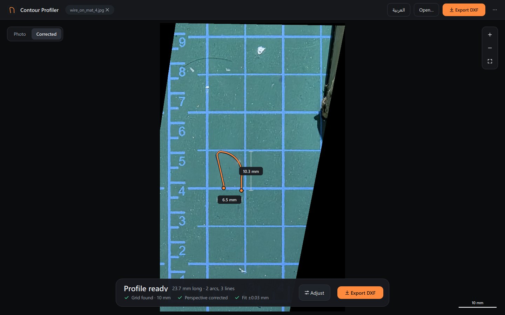
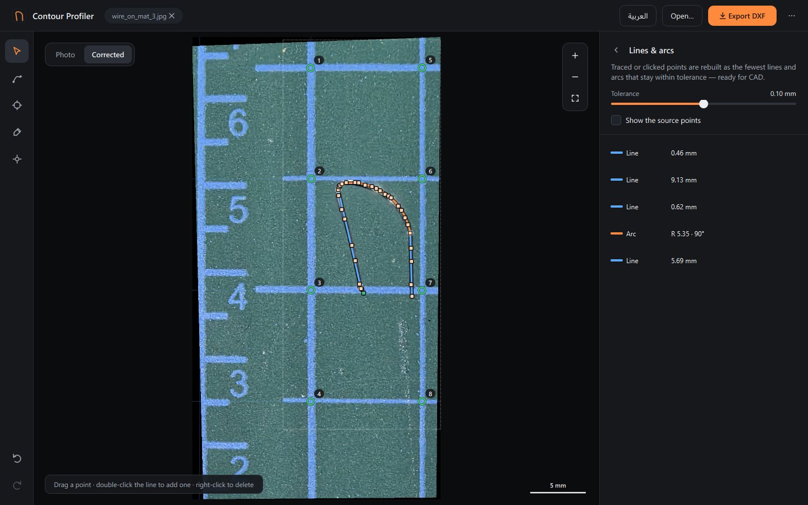
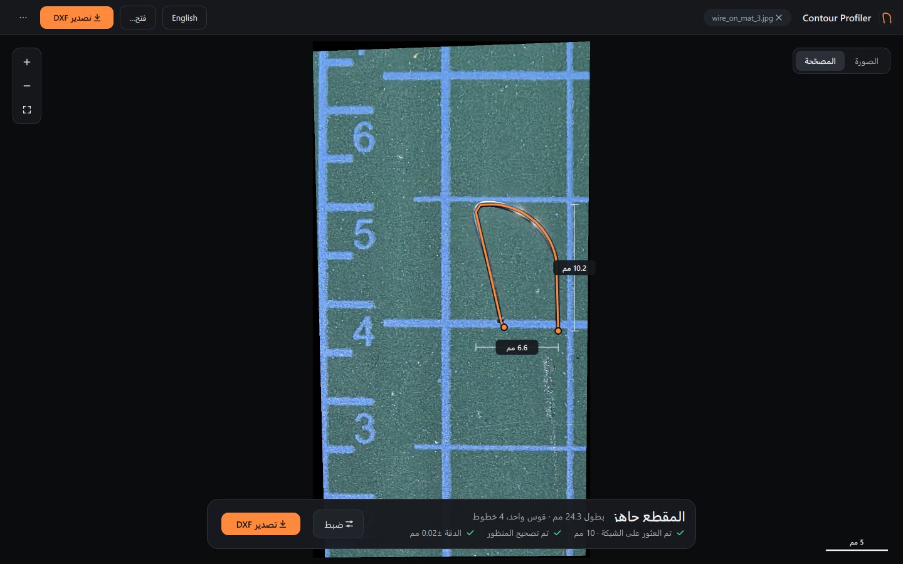

<div dir="rtl">

<p align="center"></p>

<p align="center"><a href="README.md">English</a> · <b>العربية</b></p>

# Contour Profiler

انقل المقطع العرضي لأي جسم حقيقي إلى برامج الرسم الهندسي (CAD). اثنِ سلكًا حول
الشكل، وضعه على شبكة، والتقط له صورة بالهاتف من أي زاوية، لتحصل على رسم
ثنائي الأبعاد بملف **DXF** بأبعاد دقيقة. إنه بديل سريع لمقياس المقاطع
(Profile Gauge) والقدمة لنسخ مقاطع الكرانيش والأنابيب والحواف المنحنية
وأشكال الأدوات وغيرها.



1. اثنِ سلكًا أو شريطًا معدنيًا رفيعًا حول المقطع الذي تريد نسخه.
2. ضعه على نمط مربعات: لوح قص أو ورق مربعات أو رقعة شطرنج مطبوعة.
3. التقط صورة **من أي زاوية**.
4. افتحها في Contour Profiler: تُكتشف الشبكة ويُصحَّح المنظور والمقياس
   ويُتتبَّع السلك تلقائيًا، ويمكنك مراجعة كل خطوة وتصحيحها يدويًا.
5. صدّر الناتج بصيغة DXF أو SVG أو CSV بالمليمتر.

برنامج متعدد المنصات (Windows وmacOS وLinux) مكتوب بلغة C++17 مع Qt 6.
نواة معالجة الصور (`src/core`) مكتوبة بلغة C++ القياسية دون أي مكتبات خارجية.

## المزايا

- **اكتشاف الشبكة تلقائيًا**
  - شبكات الخطوط (ألواح القص وورق المربعات) بخطوط فاتحة أو داكنة.
  - رقع الشطرنج.
  - يتحمّل المساطر والأرقام المطبوعة والخطوط المرسومة جزئيًا والانعكاسات
    والمنظور الحاد.
- **تصحيح المنظور والمقياس** عبر تحويل إسقاطي (Homography) بطريقة المربعات
  الصغرى على كل زوايا الشبكة المكتشفة، مع ملاءمة الخطوط بدقة أقل من البكسل.
  ويُظهر الخطأ لكل نقطة أي نقطة سيئة فورًا.
- **معايرة يدوية** دون أي شبكة: انقر على أي علامات معروفة واكتب إحداثياتها
  بالمليمتر، أو انقر على الزوايا الأربع لمستطيل معروف المقاس.
- **استخراج المقطع تلقائيًا**: يجد البرنامج كل ما يختلف عن نمط الخلفية
  المتكرر، ثم يتتبّع خط منتصفه (للسلك) أو حافته الخارجية (للشريط).
  - *تحديد السلك*: انقر على السلك إذا اكتُشف شيء آخر.
  - *تحديد اللون*: الاكتشاف حسب اللون للخلفيات الصعبة.
- **خطوط وأقواس (هندسة عكسية):** يُعاد بناء النقاط المتتبَّعة أو التي تنقرها
  تلقائيًا بأقل عدد من الخطوط المستقيمة والأقواس الدائرية الحقيقية ضمن تفاوت
  محدد، مع وصلات متصلة. وتُصدَّر الأقواس كأقواس DXF حقيقية (Bulges)
  وأوامر أقواس SVG.
- **التحرير:** اسحب النقاط، وانقر مرتين لإضافة نقطة، وانقر بالزر الأيمن للحذف،
  وارسم يدويًا، مع التراجع والإعادة.
- **العرض المصحّح** (بلا منظور وبالمقياس الحقيقي) مع شريط مقياس، ويمكن حفظه
  كصورة PNG تتضمن المقياس الحقيقي.
- **التصدير:**
  - DXF بإصدار R12 بالمليمتر (المحور Y للأعلى). يُفتح في AutoCAD وLibreCAD
    وFreeCAD وFusion 360 وSolidWorks وQCAD وDraftSight وInkscape وغيرها.
  - SVG بإطار عرض بالمليمتر.
  - CSV.
  - نقطة الأصل عند زاوية المقطع أو عند أصل الشبكة، مع طبقة اختيارية للشبكة
    المرجعية.
- **واجهة بالعربية والإنجليزية** مع اتجاه كامل من اليمين إلى اليسار.

> **ملفات DWG:** صيغة DWG مغلقة خاصة بشركة Autodesk. افتح ملف DXF في برنامج
> الرسم الهندسي واحفظه بصيغة DWG، أو حوّل عدة ملفات دفعة واحدة باستخدام
> برنامج ODA File Converter المجاني.

## التنزيل

النسخ الجاهزة للتشغيل موجودة في صفحة
[**الإصدارات (Releases)**](https://github.com/ahmad-amrey/countour_profiler/releases):

| المنصة | الملف | طريقة التشغيل |
|---|---|---|
| Windows 10/11 (64 بت) | `ContourProfiler-…-windows-x64.zip` | فك الضغط في أي مكان وشغّل `ContourProfiler.exe`. |
| macOS (معالجات Apple Silicon) | `ContourProfiler-…-macos-arm64.dmg` | افتحه واسحب *Contour Profiler* إلى مجلد التطبيقات. |
| Linux (x86-64، التوزيعات الحديثة) | `ContourProfiler-…-linux-x86_64.AppImage` | امنح الملف صلاحية التشغيل (`chmod +x`) ثم شغّله. |

النسخ غير موقّعة رقميًا بعد، لذا يظهر تحذير عند أول تشغيل. في Windows تظهر رسالة
SmartScreen «Windows protected your PC»: انقر *More info* ثم *Run anyway*. وفي
macOS انقر على التطبيق بالزر الأيمن ثم *Open* ثم *Open* (مرة واحدة فقط).

## ليس لديك لوح قص؟ اطبع الورقة

اطبع [`docs/calibration_sheet_10mm_A4.pdf`](docs/calibration_sheet_10mm_A4.pdf)
(أو نسخة [US Letter](docs/calibration_sheet_10mm_Letter.pdf)) بنسبة
**100 % أو «الحجم الفعلي»**. ويفتحها لك زر *طباعة ورقة معايرة* في شاشة البداية.
يتيح لك شريط الـ100 مم في الورقة التحقق من مقياس الطباعة. ولأي شبكة أخرى،
استخدم شبكتك وأدخل مقاس مربعها في البرنامج.

## نصائح للتصوير

- يجب أن يكون السلك كله على النمط، مع ظهور بعض خطوط الشبكة حوله.
- يجب أن يتباين السلك مع النمط. السلك الفضي واضح جدًا على لوح القص الأخضر.
  أما على رقعة شطرنج بالأبيض والأسود فاستخدم سلكًا نحاسيًا أو ملونًا، لأن
  السلك الفضي يختفي على المربعات البيضاء.
- استخدم الكاميرا الرئيسية للهاتف لا الكاميرا فائقة الاتساع، فتشوّه العدسة غير
  مُعالج. وتجنّب الانعكاسات والظلال الحادة.
- صوّر من الأعلى تقريبًا متى أمكن. كل الزوايا تعمل، لكن الزاوية الحادة تقلل الدقة
  في الجهة البعيدة.
- أدخل المقاس الحقيقي للمربع: 10 مم لمعظم ألواح القص وورق المربعات بالسنتيمتر.

## استخدام البرنامج

الواجهة متدرّجة: المسار الافتراضي ثلاث خطوات، والتفاصيل مخفية حتى تطلبها.

**المسار البسيط**
1. **افتح** صورة بسحبها وإفلاتها على النافذة أو بالنقر على *اختيار صورة*.
   تحقّق أولًا من مقاس مربع الشبكة، وهو 10 مم افتراضيًا.
2. **راجع النتيجة.** يعرض العرض المصحّح (بلا منظور) المقطع المتتبَّع مع أبعاده.
   وتؤكد بطاقة النتيجة العثور على الشبكة وتصحيح المنظور، وتعرض الدقة وتكوين
   المقطع بصيغة *N أقواس · M خطوط*.
3. **صدّر DXF.** الخيارات الإضافية (نقطة الأصل وطبقة الشبكة المرجعية) موجودة
   داخل نافذة التصدير.

**التفاصيل** (*ضبط*): شريط أدوات ولوحة جانبية.

| القسم | ما يمكنك فعله |
|---|---|
| **المعايرة** | نوع النمط، ومقاس المربع، وإعادة الاكتشاف. ويتيح لك قسم *النقاط المرجعية* سحب النقاط وإضافتها وحذفها وكتابة قيمها بالمليمتر. وتُلوَّن النقاط حسب الدقة: الأخضر أقل من 0.1 مم، والبرتقالي أقل من 0.3 مم، والأحمر أسوأ. |
| **اكتشاف السلك** | تلقائي أو حسب اللون، والحساسية، والتنعيم، ونطاق البحث، وخط المنتصف أو الحافة الخارجية. الأدوات: *تحديد السلك* و*تحديد لون السلك*. |
| **خطوط وأقواس** | يُعاد بناء النقاط المتتبَّعة أو المرسومة يدويًا بأقل عدد من الخطوط المستقيمة والأقواس الدائرية ضمن تفاوت محدد (0.10 مم افتراضيًا). وتعرض صفحة *تعديل* كل مقطع بطوله أو نصف قطره وزاويته، وتلوّن الخطوط بالأزرق والأقواس بالبرتقالي. |

**لم تُكتشف الشبكة؟** تظهر بطاقة إرشادية: انقر على الزوايا الأربع لمربع واحد من
الشبكة، أو لأي مستطيل تُدخل مقاسه، ويكمل البرنامج تلقائيًا.

**الرسم اليدوي:** بأداة *رسم المقطع* (`D`) انقر على بضع نقاط على طول الشكل،
فتتحول تلقائيًا إلى خطوط وأقواس، أي أن ثلاث أو أربع نقرات على منحنى تصبح قوسًا
حقيقيًا واحدًا.



اختصارات لوحة المفاتيح:

| المفتاح | الوظيفة |
|---|---|
| `Ctrl+O` | فتح صورة (السحب والإفلات يعمل أيضًا) |
| `Ctrl+W` | إغلاق الصورة والعودة إلى شاشة البداية (أو انقر × بجانب اسم الملف) |
| `F5` | تشغيل المعالجة التلقائية |
| `1` / `2` | عرض الصورة / العرض المصحّح |
| `F` | ملاءمة للنافذة |
| `E` | أداة التحرير |
| `R` | إضافة نقطة مرجعية |
| `D` | رسم المقطع |
| `O` | تحديد السلك |
| `C` | تحديد لون السلك |
| `Esc` | إنهاء الأداة الحالية |
| عجلة الفأرة | التكبير والتصغير |
| السحب بالزر الأوسط أو في مساحة فارغة | التحريك |
| `Ctrl+Z` / `Ctrl+Y` | تراجع / إعادة |
| `Ctrl+E` | تصدير DXF |

من سطر الأوامر: `ContourProfiler [photo]`

## اللغات

الإنجليزية و**العربية** مع اتجاه كامل من اليمين إلى اليسار. بدّل اللغة من زر
اللغة في الشريط العلوي، أو من القائمة ⋯ › اللغة. يتم التبديل فورًا مع الاحتفاظ
بالصورة المفتوحة والتعديلات والإعدادات، ويتذكّر البرنامج اختيارك.



لإضافة لغة أو تحديثها، عدّل جدول النصوص (`src/app/i18n_ar.inc` للعربية) ثم
تحقّق من اكتمال الترجمة:

<div dir="ltr">

```bash
python tools/check_translations.py .
```

</div>

## البناء من المصدر

المتطلبات: مترجم يدعم C++17، وCMake بإصدار 3.16 أو أحدث، وQt 6 (Core وGui وWidgets).

**Windows (MSYS2 / MinGW-w64)**

<div dir="ltr">

```bash
pacman -S mingw-w64-x86_64-gcc mingw-w64-x86_64-cmake mingw-w64-x86_64-ninja mingw-w64-x86_64-qt6-base
cmake -S . -B build -G Ninja
cmake --build build
windeployqt6 build/ContourProfiler.exe   # copy Qt DLLs next to the exe for distribution
```

</div>

يعمل أيضًا Visual Studio مع مثبّت Qt الرسمي: مرّر
`-DCMAKE_PREFIX_PATH=C:/Qt/6.x.x/msvc2022_64`.

**Linux (Debian/Ubuntu)**

<div dir="ltr">

```bash
sudo apt install build-essential cmake ninja-build qt6-base-dev libgl1-mesa-dev
cmake -S . -B build -G Ninja && cmake --build build
```

</div>

**macOS (Homebrew)**

<div dir="ltr">

```bash
brew install qt cmake ninja
cmake -S . -B build -G Ninja -DCMAKE_PREFIX_PATH="$(brew --prefix qt)" && cmake --build build
macdeployqt build/ContourProfiler.app    # optional: self-contained bundle
```

</div>

خيارات CMake: الخيار `-DCP_BUILD_GUI=OFF` يبني النواة والاختبارات فقط، والخيار
`-DCP_BUILD_TESTS=OFF` يتخطى الاختبارات.

## إصدار نسخة جديدة

1. حدّد رقم الإصدار الجديد في `CMakeLists.txt`
   (`project(ContourProfiler VERSION x.y.z ...)`) واحفظ التغيير (commit). يقرأ
   البرنامج وتفاصيل ملف Windows والإصدار الرقم من هناك.
2. ضع على الـcommit وسمًا (tag) بالرقم نفسه وادفعه:

<div dir="ltr">

```bash
git tag v0.3.0
git push origin v0.3.0
```

</div>

يتحقق مسار العمل `release` من تطابق الوسم مع رقم الإصدار، ثم يبني البرنامج
ويختبره على المنصات الثلاث، ويحزّم ملف zip لنظام Windows وصورة قرص لنظام macOS
وملف AppImage لنظام Linux، وينشرها كإصدار على GitHub. ولتجربة التحزيم دون نشر
إصدار، شغّل مسار العمل يدويًا من تبويب Actions، فتظهر الحزم كملفات مرفقة بالتشغيل.

## الاختبارات والدقة

<div dir="ltr">

```bash
ctest --test-dir build --output-on-failure
```

</div>

- **`line_arc_fitting`**: خطوط وأقواس معروفة، تُؤخذ كتتبّع كثيف فيه ضوضاء وكبضع
  نقرات يدوية، ويجب أن تعود بالبنية نفسها وأنصاف الأقطار نفسها (بفارق أقل من
  0.1 مم)، وأن تبقى الأقواس سليمة بعد المرور بصيغة DXF.
- **`printed_calibration_sheets`**: تُرسم ورقة المعايرة القابلة للطباعة (A4 وLetter)
  وعليها سلك، ثم تُصوَّر بمنظور مائل. ويجب أن يستعيد البرنامج السلك بانحراف شكل
  (RMS) أقل من 0.15 مم.
- **`synthetic_ground_truth`**: يرسم صورًا بمنظور مائل وهندسة معروفة (شبكات خطوط
  فاتحة وداكنة ورقعة شطرنج، مع ضوضاء وتعتيم للأطراف) ويقارن النتيجة بالقيم
  الحقيقية.
  - خطأ زوايا الشبكة: 0.05 مم أو أقل.
  - خطأ المقطع: المتوسط نحو 0.02 مم، والأقصى 0.25 مم أو أقل.
- **`reference_photos_consistency`**: أربع صور حقيقية للسلك *نفسه* على لوح قص
  (`tests/data`)، من التصوير العمودي حتى الزاوية المائلة جدًا. ويجب أن تتطابق
  المقاطع بعد المحاذاة. النتيجة الحالية: انحراف شكل بين 0.03 و0.05 مم، والطول
  ضمن ±3 %. الطرفان هما الجزء الأقل يقينًا (±0.4 مم بسبب كتل الأطراف المقطوعة
  والظلال والانعكاسات)، فاسحب نقطتي الطرفين إن كان الطرف الدقيق مهمًا.

الأداة `cp_selftest` تعمل أيضًا كأداة معالجة دفعية:

<div dir="ltr">

```bash
cp_selftest run out_dir 10 photo1.jpg photo2.jpg   # writes overlays, rectified images, DXF
```

</div>

أُعيد ترميز صور `tests/data` دون أي بيانات وصفية (لا EXIF ولا GPS).

## كيف يعمل

1. **اكتشاف الشبكة** (`grid_detect.cpp`):
   - مرشّح حواف متعدد المقاييس مبني على مصفوفة هيسيان (Hessian).
   - تحويل هاف (Hough) مقيّد بالاتجاه، تُوزن أصواته بالطول حتى لا تطغى مقاطع
     السلك اللامعة القصيرة.
   - عائلتان من الخطوط تُرشَّحان باتساق نقطة التلاشي (RANSAC) وبالتباعد.
   - تقاطعاتهما تصبح زوايا مرشّحة. أما رقع الشطرنج فتستخدم نقاط السرج من هيسيان.
   - تنمو الشبكة من خلية أولى بالاستقراء، ويجب أن تقع كل حافة على خط مرسوم، مما
     يستبعد علامات المسطرة والأرقام.
   - تُملأ الفجوات عبر التحويل الإسقاطي المُلاءَم، وتُحذف النقاط الشاذة بدءًا
     بالأسوأ.
   - تدقيق أقل من البكسل: ملاءمة الخطين محليًا عند كل تقاطع، أو ملاءمة السرج
     بالتدرّج لرقع الشطرنج.
2. **المعايرة** (`calib.cpp` و`geom.cpp`): تحويل إسقاطي بطريقة DLT المُطبَّعة
   مُلاءَم على كل النقاط المرجعية، مع خطأ كل نقطة بالمليمتر.
3. **استخراج المقطع** (`profile_detect.cpp`):
   - تُصحَّح الصورة بدقة تحليل يكون فيها طول دورة النمط عددًا صحيحًا من البكسلات.
   - نموذج الخلفية: الوسيط لكل بكسل من الطور نفسه في الدورات المجاورة مع مقدار
     تشتته. ويُطبَّع الفرق بالنسبة للضوضاء ويتحمل خطأ محاذاة بمقدار بكسل واحد.
   - تُنعَّم الخريطة بمقدار نصف عرض السلك، فتندمج الحافتان اللامعتان للسلك
     الدائري العاكس، ثم تُطبَّق عتبة مزدوجة (Hysteresis).
   - تُجمَّع القطع المتقاربة، ويُختار أكبر جسم ممدود لا يلمس الحافة، أو الجسم
     الذي تنقر عليه.
   - التنحيف يعطي الهيكل، ثم يُؤخذ أطول مسار فيه مع سد الفجوات، وتُقص الانحناءات
     الحادة عند الطرفين ويُمدّ المسار حتى الأطراف الحقيقية، ثم يُنعَّم ويُبسَّط.
4. **الخطوط والأقواس** (`fit.cpp`): برمجة ديناميكية على نقاط التقسيم تجد أقل
   عدد من المقاطع ضمن التفاوت. يكون الامتداد خطًا إذا كانت كل نقاطه ضمن التفاوت
   من الوتر، وإلا فقوسًا يمر بطرفيه ويقع مركزه على المنصّف العمودي للوتر ويُحسب
   بصيغة مغلقة، بشرط أن تتقدم النقاط في اتجاه واحد حوله. وعند التعادل يُختار
   الحل الأدق.
5. **التصدير** (`export.cpp`): عناصر POLYLINE بصيغة DXF R12 مع Bulges للأقواس،
   ومسارات SVG بأوامر أقواس، وCSV، وكلها بالمليمتر.

## الشعار والأيقونات

الشعار مقطع سلك مثنيّ على شبكة معايرة: [`resources/logo.svg`](resources/logo.svg).
وتُولَّد أيقونات كل المنصات من الهندسة نفسها بالأمر
`python tools/make_icons.py` (يحتاج مكتبة Pillow): `icon.ico` (مضمّنة في ملف
Windows التنفيذي)، و`icon.icns` (حزمة macOS)، وصور PNG بعدة مقاسات (أيقونة
النافذة وLinux).

## هيكل المشروع

<div dir="ltr">

```
src/core/   image processing, geometry, detection, export (no Qt)
src/app/    Qt GUI (main window, canvas, translations)
resources/  logo, icons, Windows .rc, Qt .qrc, Linux .desktop
docs/       printable calibration sheets (PDF)
tools/      icon generator, translation checker
tests/      self-test / batch tool, reference photos
```

</div>

## القيود

- تشوّه العدسة غير مُعالج.
- يجب أن يكون النمط مسطحًا. سُمك السلك يرفعه قليلًا عن المستوى، وهذا الأثر
  مهمل للسلك الرفيع عندما تكون الكاميرا على بعد أكثر من 20 سم تقريبًا.
- يحتاج الاكتشاف إلى بعض التباين بين السلك والنمط. إذا فشل الاكتشاف التلقائي،
  فاستخدم وضع اللون أو عدّل الحساسية أو ارسم المقطع يدويًا.

## الترخيص

[MIT](LICENSE) © 2026 Ahmad AlAmrey

## برمجيات الطرف الثالث

مبني باستخدام [Qt 6](https://www.qt.io/) (Core وGui وWidgets) وفق رخصة GNU LGPL v3
مع ربط ديناميكي. عند توزيع الملفات التنفيذية، وزّع مكتبات Qt كملفات منفصلة
(يتولى ذلك `windeployqt6` و`macdeployqt`) وأرشد المستخدمين إلى الشيفرة المصدرية
لمكتبة Qt. أما بقية المشروع (`src/core`) فلا تستخدم إلا مكتبة C++ القياسية.

</div>
