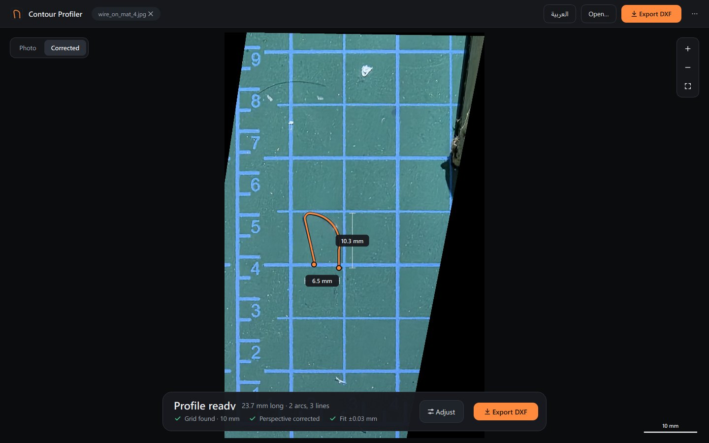
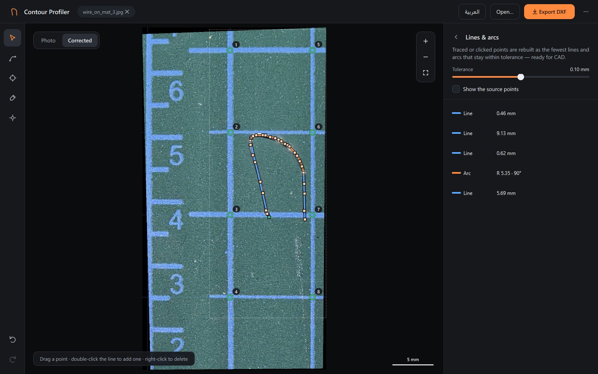
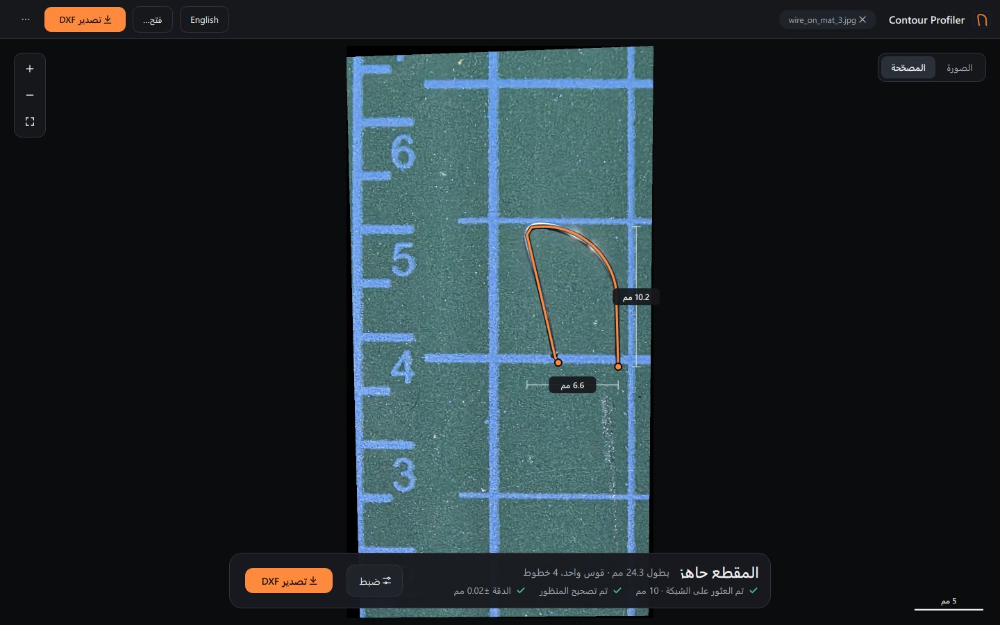

<p align="center"></p>

<p align="center"><b>English</b> · <a href="README.ar.md">العربية</a></p>

# Contour Profiler

Copy the cross-section of any real object into CAD. Bend a wire around the
shape, lay it on a grid and take a photo from any angle: you get an accurate 2D
drawing as a **DXF**. It's a quick replacement for a profile gauge and calipers
when you need the profile of a moulding, pipe, curved edge, tool or any other
part.



1. Bend a wire or thin metal strip over the contour you want to copy.
2. Lay it on a square pattern: a cutting mat, graph paper or a printed checkerboard.
3. Take a photo, **from any angle**.
4. Open it in Contour Profiler. The grid is found, the perspective and scale are
   corrected, and the wire is traced automatically. Every step can be checked and
   corrected by hand.
5. Export DXF / SVG / CSV in millimetres.

Cross-platform C++17 + Qt 6 (Windows, macOS, Linux). The image-processing core
(`src/core`) is plain C++ with no dependencies.

## Features

- **Automatic grid detection**
  - Line grids (cutting mats, graph paper), light or dark lines.
  - Checkerboards.
  - Robust to rulers, printed digits, partly drawn lines, glare and strong perspective.
- **Perspective and scale correction** via a least-squares homography over all
  detected grid corners, with sub-pixel line fitting. Per-point residuals show
  bad points at a glance.
- **Manual calibration** works without any grid. Click any known marks, type
  their mm coordinates, or click the 4 corners of a known rectangle.
- **Automatic profile extraction** finds whatever differs from the periodic
  background, then traces its centre line (wire) or outline (strip).
  - *Pick object*: click the wire if something else was found.
  - *Pick colour*: detect by colour for difficult backgrounds.
- **Lines & arcs (reverse engineering):** traced or clicked points are
  automatically rebuilt as the fewest straight lines and true circular arcs
  within a tolerance. Joints are continuous. Arcs export as real DXF arcs
  (polyline bulges) and SVG arc commands.
- **Editing**: drag points, double-click to insert, right-click to delete, draw
  by hand, and undo/redo.
- **Corrected view** (perspective removed, true scale) with a scale bar. It can be saved as a PNG with the
  true scale embedded.
- **Export**:
  - DXF R12 in mm with Y up. It opens in AutoCAD, LibreCAD, FreeCAD, Fusion 360,
    SolidWorks, QCAD, DraftSight, Inkscape and others.
  - SVG with a mm viewBox.
  - CSV.
  - Origin at the profile corner or the grid origin, and an optional
    reference-grid layer.
- **English and Arabic** interface, with a full right-to-left layout.

> **DWG:** DWG is a closed Autodesk format. Open the DXF in your CAD program and
> *Save As* DWG, or batch-convert with the free ODA File Converter.

## Download

Ready-to-run builds are on the
[**Releases**](https://github.com/ahmad-amrey/countour_profiler/releases) page:

| Platform | File | How to start |
|---|---|---|
| Windows 10/11 (64-bit) | `ContourProfiler-…-windows-x64.zip` | Unzip anywhere and run `ContourProfiler.exe`. |
| macOS (Apple Silicon) | `ContourProfiler-…-macos-arm64.dmg` | Open it and drag *Contour Profiler* to Applications. |
| Linux (x86-64, recent distributions) | `ContourProfiler-…-linux-x86_64.AppImage` | `chmod +x` the file, then run it. |

The builds are not code-signed yet, so the first start shows a warning. On
Windows, SmartScreen says "Windows protected your PC": click *More info* →
*Run anyway*. On macOS, right-click the app → *Open* → *Open* (only once).

## No cutting mat? Print the sheet

Print [`docs/calibration_sheet_10mm_A4.pdf`](docs/calibration_sheet_10mm_A4.pdf)
(or the [US Letter](docs/calibration_sheet_10mm_Letter.pdf) version) at
**100 % / Actual size**. *Print a calibration sheet* on the start screen opens
it for you. The 100 mm bar on the sheet lets you check the printed scale. For
any other grid, use your own and enter its square size in the app.

## Taking good photos

- The whole wire must lie on the pattern, with a few grid lines visible around it.
- The wire must contrast with the pattern. Silver wire works well on a green
  cutting mat. On a black-and-white checkerboard, use a copper or coloured wire,
  because silver disappears on white squares.
- Use the phone's main camera rather than the ultra-wide one: lens distortion is
  not modelled. Avoid glare and hard shadows.
- Shoot roughly from above when you can. Any angle works, but a steep angle
  lowers resolution on the far side.
- Enter the real square size: 10 mm for typical cutting mats and 1 cm graph paper.

## Using the application

The interface is tiered. The default path is three steps, and the details
stay out of the way until you ask for them.

**Simple path**
1. **Open** a photo by dropping it on the window or clicking *Choose photo*.
   Check the grid square size first; it defaults to 10 mm.
2. **Check the result.** The corrected view (perspective removed) shows the traced profile with its size.
   The result card confirms the grid was found and the perspective corrected,
   and shows the fit quality and the profile as *N arcs · M lines*.
3. **Export DXF.** More options (origin, reference-grid layer) sit behind a
   disclosure in the export sheet.

**Details** (*Adjust*): a tool rail and a side panel.

| Section | What you can do |
|---|---|
| **Calibration** | Pattern type, square size, detect again. *Reference points* lets you drag, add or delete points and type their mm values. Points are coloured by fit: green < 0.1 mm, orange < 0.3 mm, red worse. |
| **Wire detection** | Automatic or by colour, sensitivity, smoothing, search margin, centre line or outline. Tools: *Pick the wire* and *Pick colour*. |
| **Lines & arcs** | The traced or hand-placed points are rebuilt as the fewest straight lines and circular arcs within a tolerance (default 0.10 mm). The *edit* page lists every segment with its length or radius and sweep, and colours lines blue and arcs orange on the canvas. |

**No grid detected?** A guided card appears: click the 4 corners of one grid
square, or of any rectangle whose size you enter, and the flow continues
automatically.

**Drawing by hand:** with *Draw profile* (`D`), click a few points along the
shape. They are turned into lines and arcs automatically, so three or four
clicks on a curve become one true arc.



Shortcuts:

| Key | Action |
|---|---|
| `Ctrl+O` | Open a photo (drag and drop also works) |
| `Ctrl+W` | Close the photo and return to the start screen (or click × on the file name) |
| `F5` | Run the automatic pipeline |
| `1` / `2` | Photo / corrected view |
| `F` | Fit to window |
| `E` | Edit tool |
| `R` | Add reference point |
| `D` | Draw profile |
| `O` | Pick the wire |
| `C` | Pick wire colour |
| `Esc` | Finish the current tool |
| Wheel | Zoom |
| Middle drag, or drag empty space | Pan |
| `Ctrl+Z` / `Ctrl+Y` | Undo / redo |
| `Ctrl+E` | Export DXF |

Command line: `ContourProfiler [photo]`

## Languages

English and **Arabic (العربية)**, with a full right-to-left layout. Switch with
the language button in the header, or ⋯ › Language. The switch is instant:
the open photo, edits and settings are kept, and the choice is remembered.



To add or update a language, edit the string table (`src/app/i18n_ar.inc` for
Arabic) and check coverage:

```bash
python tools/check_translations.py .
```

## Building

Requirements: a C++17 compiler, CMake ≥ 3.16 and Qt 6 (Core, Gui, Widgets).

**Windows (MSYS2 / MinGW-w64)**

```bash
pacman -S mingw-w64-x86_64-gcc mingw-w64-x86_64-cmake mingw-w64-x86_64-ninja mingw-w64-x86_64-qt6-base
cmake -S . -B build -G Ninja
cmake --build build
windeployqt6 build/ContourProfiler.exe   # copy Qt DLLs next to the exe for distribution
```

Visual Studio with the official Qt installer also works: pass
`-DCMAKE_PREFIX_PATH=C:/Qt/6.x.x/msvc2022_64`.

**Linux (Debian/Ubuntu)**

```bash
sudo apt install build-essential cmake ninja-build qt6-base-dev libgl1-mesa-dev
cmake -S . -B build -G Ninja && cmake --build build
```

**macOS (Homebrew)**

```bash
brew install qt cmake ninja
cmake -S . -B build -G Ninja -DCMAKE_PREFIX_PATH="$(brew --prefix qt)" && cmake --build build
macdeployqt build/ContourProfiler.app    # optional: self-contained bundle
```

CMake options: `-DCP_BUILD_GUI=OFF` builds only the core and the tests;
`-DCP_BUILD_TESTS=OFF` skips the tests.

## Making a release

1. Set the new version in `CMakeLists.txt` (`project(ContourProfiler VERSION x.y.z ...)`)
   and commit. The app, the Windows file details and the release all read it
   from there.
2. Tag the commit with the same version and push the tag:

   ```bash
   git tag v0.1.0
   git push origin v0.1.0
   ```

The `release` workflow checks that the tag matches the version, builds and
tests on all three platforms, packages a Windows zip, a macOS disk image and a
Linux AppImage, and publishes them as a GitHub Release. To try the packaging
without releasing, run the workflow manually from the Actions tab; the packages
appear as run artifacts.

## Tests and accuracy

```bash
ctest --test-dir build --output-on-failure
```

- **`line_arc_fitting`**: known lines and arcs, sampled as a dense noisy trace and as a few hand-placed clicks, must come back with the same structure and radii (within 0.1 mm), and arcs must round-trip through the DXF bulges.
- **`printed_calibration_sheets`**: the printable sheet (A4 and Letter) is rendered with a wire on it and photographed in perspective. The pipeline must recover the wire with a shape RMS below 0.15 mm.
- **`synthetic_ground_truth`**: renders perspective photos with known geometry
  (bright and dark line grids, a checkerboard, noise, vignetting) and compares
  the result with the ground truth.
  - Grid corner error: ≤ 0.05 mm.
  - Profile error: mean ≈ 0.02 mm, max ≤ 0.25 mm.
- **`reference_photos_consistency`**: four real photos of the *same* wire on a
  cutting mat (`tests/data`), taken from top-down to strongly oblique. The
  profiles must agree after rigid alignment. Current result: shape RMS
  0.03–0.05 mm, length within ±3 %. The tips are the least certain part
  (±0.4 mm, from cut-end blobs, shadows and glare); drag the end vertices if the
  exact tip matters.

`cp_selftest` is also a batch tool:

```bash
cp_selftest run out_dir 10 photo1.jpg photo2.jpg   # writes overlays, rectified images, DXF
```

The `tests/data` images were re-encoded without any metadata (no EXIF/GPS).

## How it works

1. **Grid detection** (`grid_detect.cpp`):
   - Multi-scale Hessian ridge filter.
   - Orientation-gated Hough transform, with votes weighted by length so bright
     specular wire segments cannot dominate.
   - Two line families, filtered by vanishing-point consistency (RANSAC) and spacing.
   - Their intersections become corner candidates. Checkerboards use Hessian
     saddle points instead.
   - From a seed unit cell the lattice is grown by extrapolation. Every edge must
     lie on a drawn line, which rejects ruler ticks and digits.
   - Holes are filled through the fitted homography, and outliers are removed
     worst-first.
   - Sub-pixel refinement: local fits of both lines at each crossing, or a
     gradient saddle fit for checkerboards.
2. **Calibration** (`calib.cpp`, `geom.cpp`): normalised DLT homography fitted to
   all reference points, with per-point residuals in mm.
3. **Profile extraction** (`profile_detect.cpp`):
   - The photo is rectified at an analysis resolution where one pattern period
     is a whole number of pixels.
   - Background model: per-pixel median of the same pattern phase in the
     neighbouring periods, plus its spread. The difference is noise-normalised
     and tolerant to 1 px misregistration.
   - The map is smoothed at the wire's half-width, which fuses the bright edges
     of a round reflective wire, then a hysteresis threshold is applied.
   - Nearby pieces are grouped. The largest elongated object not touching the
     border is chosen, or the one you click.
   - Thinning gives the skeleton; the longest path through it, with gaps
     bridged, is trimmed of end kinks and extended to the physical tips.
     Then it is smoothed and simplified.
4. **Lines & arcs** (`fit.cpp`): dynamic programming over break points finds
   the fewest segments within tolerance. Each span is a line if every point is
   within tolerance of the chord. Otherwise it is an arc through both end
   points, with its centre on the chord bisector fitted in closed form, as long
   as the points progress monotonically around it. Ties go to the more
   accurate solution.
5. **Export** (`export.cpp`): DXF R12 POLYLINE entities with bulges for arcs,
   SVG paths with arc commands, and CSV, all in mm.

## Logo and icons

The logo is a bent-wire profile on a calibration grid: [`resources/logo.svg`](resources/logo.svg).
Every platform icon is generated from the same geometry by
`python tools/make_icons.py` (needs Pillow): `icon.ico` (embedded in the Windows
.exe), `icon.icns` (macOS bundle) and PNG sizes (window icon, Linux).

## Project layout

```
src/core/   image processing, geometry, detection, export (no Qt)
src/app/    Qt GUI (main window, canvas, translations)
resources/  logo, icons, Windows .rc, Qt .qrc, Linux .desktop
docs/       printable calibration sheets (PDF)
tools/      icon generator, translation checker
tests/      self-test / batch tool, reference photos
```

## Limitations

- Lens distortion is not modelled.
- The pattern must be flat. The wire's thickness raises it slightly above the
  plane. That effect is negligible for thin wire and a camera more than ~20 cm away.
- Detection needs some contrast between the wire and the pattern. If automatic
  detection fails, use colour mode, adjust the threshold or draw the profile by hand.

## License

[MIT](LICENSE) © 2026 Ahmad AlAmrey

## Third-party software

Built with [Qt 6](https://www.qt.io/) (Core, Gui, Widgets), used under the
GNU LGPL v3 and linked dynamically. When you distribute binaries, ship the Qt
libraries as separate files (`windeployqt6` / `macdeployqt` do this) and point
users to the Qt source code. Everything else (`src/core`) uses only the C++
standard library.
